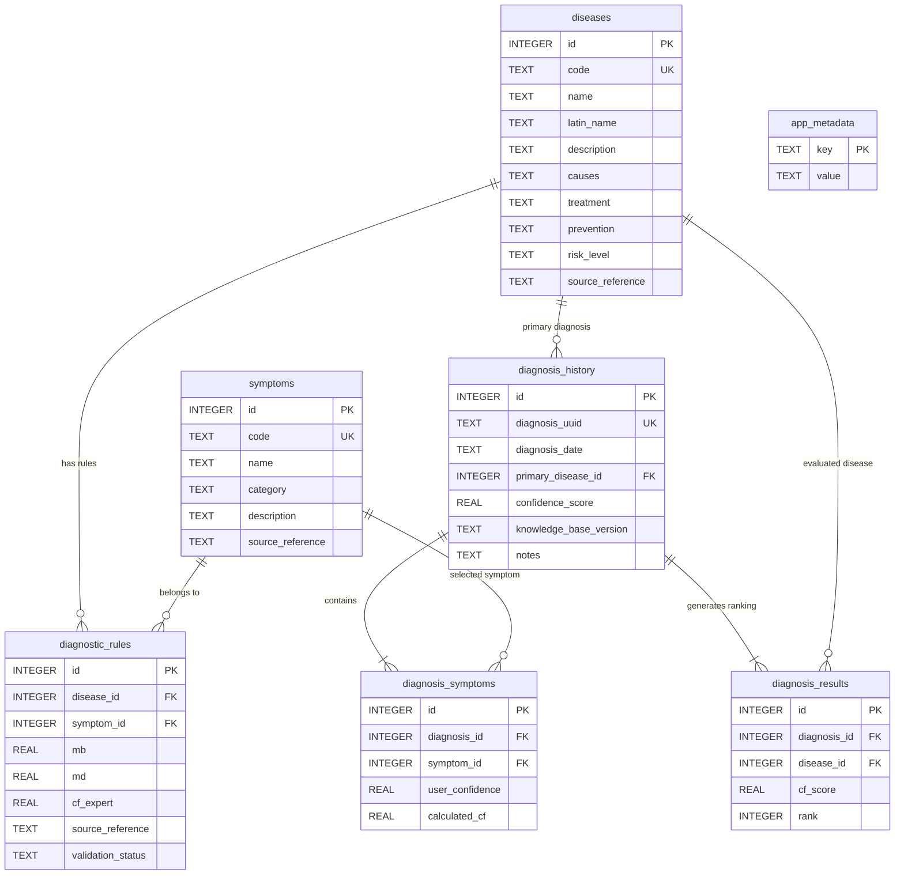

# DATA DICTIONARY & KNOWLEDGE BASE SPECIFICATION
## AyamCare — Sistem Pakar Diagnosis Penyakit Ayam Broiler

**Versi Dokumen:** 1.0.0  
**Tanggal:** 8 November 2026  
**Status:** Phase 1 Deliverable — Kamus Data & Skema Database SQLite  

---

## 1. Skema Database Relasional (SQLite)

Database beroperasi secara lokal (*offline-first*) menggunakan SQLite (`ayamcare.db`). Foreign keys diaktifkan (`PRAGMA foreign_keys = ON;`).

---

## 2. Definisi Tabel SQLite

### 2.1 Tabel `diseases`
Menyimpan katalog penyakit ayam broiler.

| Kolom | Tipe | Constraint | Keterangan |
| :--- | :--- | :--- | :--- |
| `id` | INTEGER | PRIMARY KEY AUTOINCREMENT | Identifier unik internal |
| `code` | TEXT | UNIQUE NOT NULL | Kode patologi standar jurnal (`P01` – `P13`) |
| `name` | TEXT | NOT NULL | Nama lazim di peternakan (Indonesia) |
| `latin_name` | TEXT | NOT NULL | Nama taksonomi / ilmiah patogen |
| `description` | TEXT | NOT NULL | Deskripsi klinis perjalanan penyakit |
| `causes` | TEXT | NOT NULL | Etiologi (virus, bakteri, protozoa) |
| `treatment` | TEXT | NOT NULL | Panduan pertolongan awal & medikasi |
| `prevention` | TEXT | NOT NULL | Tindakan biosekuriti & pencegahan vaksinasi |
| `risk_level` | TEXT | NOT NULL | `TINGGI`, `SEDANG`, `KRITIS` |
| `source_reference` | TEXT | NOT NULL | Sitasi jurnal dan nomor tabel asal |

---

### 2.2 Tabel `symptoms`
Menyimpan katalog gejala klinis teramati.

| Kolom | Tipe | Constraint | Keterangan |
| :--- | :--- | :--- | :--- |
| `id` | INTEGER | PRIMARY KEY AUTOINCREMENT | Identifier unik internal |
| `code` | TEXT | UNIQUE NOT NULL | Kode gejala artikel (`G01` – `G40`) |
| `name` | TEXT | NOT NULL | Deskripsi tampilan klinis gejala |
| `category` | TEXT | NOT NULL | `Pernapasan`, `Pencernaan`, `Saraf & Perilaku`, `Kepala & Fasial`, `Fisik & Performa` |
| `description` | TEXT | NULL | Petunjuk detail cara peternak mengamati gejala |
| `source_reference` | TEXT | NOT NULL | Sitasi jurnal primer |

---

### 2.3 Tabel `diagnostic_rules`
Menghubungkan gejala dengan penyakit disertai bobot inferensi Certainty Factor.

| Kolom | Tipe | Constraint | Keterangan |
| :--- | :--- | :--- | :--- |
| `id` | INTEGER | PRIMARY KEY AUTOINCREMENT | ID relasi aturan |
| `disease_id` | INTEGER | FK -> `diseases(id)` | Relasi ke entitas penyakit |
| `symptom_id` | INTEGER | FK -> `symptoms(id)` | Relasi ke entitas gejala |
| `mb` | REAL | NOT NULL DEFAULT 0.0 | *Measure of Belief* pakar ($0.0 \le MB \le 1.0$) |
| `md` | REAL | NOT NULL DEFAULT 0.0 | *Measure of Disbelief* pakar ($0.0 \le MD \le 1.0$) |
| `cf_expert` | REAL | NOT NULL | $CF_{pakar} = MB - MD$ (rentang $-1.0 \le CF \le 1.0$) |
| `source_reference` | TEXT | NOT NULL | Rujukan tabel / halaman jurnal |
| `validation_status` | TEXT | NOT NULL | `SOURCE_VERIFIED`, `EXPERT_VALIDATED`, `APPROVED_FOR_PRODUCTION` |

---

### 2.4 Tabel `diagnosis_history`
Menyimpan riwayat sesi konsultasi diagnosis secara lokal di perangkat peternak.

| Kolom | Tipe | Constraint | Keterangan |
| :--- | :--- | :--- | :--- |
| `id` | INTEGER | PRIMARY KEY AUTOINCREMENT | ID riwayat |
| `diagnosis_uuid` | TEXT | UNIQUE NOT NULL | UUID sesi pemeriksaan |
| `diagnosis_date` | TEXT | NOT NULL | Format ISO-8601 (`YYYY-MM-DDTHH:MM:SSZ`) |
| `primary_disease_id`| INTEGER | FK -> `diseases(id)` | Penyakit hasil ranking 1 tertinggi |
| `confidence_score` | REAL | NOT NULL | Persentase kepastian ($0.0$ s.d. $100.0$) |
| `knowledge_base_version`| TEXT | NOT NULL | Versi aturan yang digunakan saat diagnosa |
| `notes` | TEXT | NULL | Catatan tambahan kondisi kandang / umur ayam |

---

### 2.5 Tabel `diagnosis_symptoms`
Mencatat rincian gejala yang dicentang beserta tingkat keyakinan peternak ($CF_{user}$).

| Kolom | Tipe | Constraint | Keterangan |
| :--- | :--- | :--- | :--- |
| `id` | INTEGER | PRIMARY KEY AUTOINCREMENT | ID baris |
| `diagnosis_id` | INTEGER | FK -> `diagnosis_history(id)` ON DELETE CASCADE | Relasi sesi |
| `symptom_id` | INTEGER | FK -> `symptoms(id)` | Gejala terpilih |
| `user_confidence` | REAL | NOT NULL | Nilai $CF_{user}$ ($0.2, 0.5, 0.8, 1.0$) |
| `calculated_cf` | REAL | NOT NULL | Hasil perkalian $CF_{user} \times CF_{pakar}$ |

---

### 2.6 Tabel `diagnosis_results`
Menyimpan semua alternatif penyakit (*differential diagnoses*) yang memiliki probabilitas $> 0$.

| Kolom | Tipe | Constraint | Keterangan |
| :--- | :--- | :--- | :--- |
| `id` | INTEGER | PRIMARY KEY AUTOINCREMENT | ID baris |
| `diagnosis_id` | INTEGER | FK -> `diagnosis_history(id)` ON DELETE CASCADE | Relasi sesi |
| `disease_id` | INTEGER | FK -> `diseases(id)` | Penyakit kandidat |
| `cf_score` | REAL | NOT NULL | Skor kombinasi akhir ($0.0 \le CF \le 1.0$) |
| `rank` | INTEGER | NOT NULL | Urutan probabilitas ($1, 2, 3, \dots$) |

---

### 2.7 Tabel `app_metadata`
Konfigurasi key-value aplikasi lokal.

| Kolom | Tipe | Constraint | Keterangan |
| :--- | :--- | :--- | :--- |
| `key` | TEXT | PRIMARY KEY | Kunci konfigurasi (misal `kb_version`, `installed_at`) |
| `value` | TEXT | NOT NULL | Nilai konfigurasi |

---

## 3. Inventarisasi Lengkap 13 Penyakit AyamCare

| ID | Kode | Nama Penyakit | Nama Ilmiah / Patogen | Tingkat Risiko | Penanganan Cepat |
| :--- | :--- | :--- | :--- | :--- | :--- |
| 1 | **P01** | Berak Kapur | *Pullorum Disease* (*Salmonella pullorum*) | Tinggi | Isolasi anak ayam bergejala, berikan antibiotik sulfa/amoksisilin, sanitasi ketat baki pakan dan brooder. |
| 2 | **P02** | Kolera Ayam | *Fowl Cholera* (*Pasteurella multocida*) | Sangat Tinggi | Injeksi antibiotik berspektrum luas (oxytetracycline/penicillin), buang bangkai segera, desinfeksi kandang harian. |
| 3 | **P03** | Flu Burung | *Avian Influenza* (HPAI H5N1) | Kritis (Zoonosis) | **Lapor dinas peternakan segera.** Terapkan *stamping out* (pemusnahan terbatas) dan karantina zona merah 1 km. |
| 4 | **P04** | Tetelo | *Newcastle Disease* (ND / APMV-1) | Kritis | Tidak ada obat antivirus. Pisahkan ayam bergejala saraf, berikan multivitamin dosis tinggi dan terapi suportif anti-stres. |
| 5 | **P05** | Tipus Ayam | *Fowl Typhoid* (*Salmonella gallinarum*) | Tinggi | Klorinasi air minum, berikan antibiotik golongan fluoroquinolone atau tetrasiklin sesuai resep dokter hewan. |
| 6 | **P06** | Berak Darah | *Coccidiosis* (*Eimeria tenella / necatrix*) | Sedang - Tinggi | Pemberian koksidiostat (*Toltrazuril*, *Sulfaquinoxaline*, atau *Amprolium*) via air minum 3–5 hari, jaga sekam tetap kering. |
| 7 | **P07** | Gumboro | *Gumboro Disease* (IBD / Birnavirus) | Tinggi | Berikan air gula merah 2% + larutan elektrolit elektrolit ginjal untuk menahan dehidrasi, hindari antibiotik nefrotoksik. |
| 8 | **P08** | Salesma Ayam | *Infectious Coryza* (*Avibacterium paragallinarum*) | Sedang | Terapi antibiotik eritromisin, tylosin, atau enrofloksasin. Bersihkan kerak eksudat pada lubang hidung ayam. |
| 9 | **P09** | Batuk Ayam Menahun | *Infectious Bronchitis* (IB / Coronavirus) | Sedang - Tinggi | Naikkan suhu brooding jika menyerang anak ayam, semprot antiseptik udara ringan, berikan ekspektoran dan vitamin ADE. |
| 10 | **P10** | Busung Ayam | *Lymphoid Leukosis* (ALV / Retrovirus) | Sedang | *Culling* (afkir selektif) ayam yang perutnya membuncit cairan, sterilisasi kandang sebelum *chick-in* periode berikutnya. |
| 11 | **P11** | Batuk Darah | *Infectious Laryngotracheitis* (ILT / Gallid herpesvirus 1) | Tinggi | Minimalkan debu dan amonia kandang, pisahkan ayam yang menjulurkan leher tersengal, berikan multivitamin dan mukolitik. |
| 12 | **P12** | Mareks | *Marek's Disease* (MDV / Herpesvirus) | Tinggi | Tidak ada pengobatan kuratif efektif. Kunci penanganan adalah vaksinasi subkutan saat umur 1 hari (*Day Old Chick* di hatchery). |
| 13 | **P13** | CRD | *Chronic Respiratory Disease* (*Mycoplasma gallisepticum*) | Sedang | Berikan antibiotik kombinasi makrolida (Tylosin + Doxycycline), perbaiki ventilasi sirkulasi udara kandang untuk menurunkan amonia. |

---

## 4. Klasifikasi Kategori Gejala Klinis (40 Gejala)

Untuk memudahkan peternak saat mengamati kawanan di kandang, 40 gejala klinis dikelompokkan ke dalam **5 kategori biologis terstruktur**:

1. **Pernapasan (Respiratori):**  
   - G02 (Nafas sesak), G03 (Nafas ngorok basah), G04 (Bersin-bersin), G05 (Batuk), G07/G23 (Keluar cairan dari hidung), G31/G34 (Batuk berdarah), G35 (Lendir bercampur darah pada rongga mulut).
2. **Pencernaan & Feses:**  
   - G08 (Fase bintik-bintik kuning), G14 (Peradangan dubur), G16 (Kotoran kuning kehijauan), G18 (Mencret putih), G33 (Mematuk daerah kloaka), G38 (Kotoran berdarah).
3. **Saraf & Perilaku:**  
   - G11 (Kepala berputar / tortikolis), G15 (Kejang-kejang), G17 (Lumpuh sayap/kaki), G19 (Paruh ditaruh di dasar lantai), G30 (Bergerombol di sudut kandang).
4. **Kepala & Fasial:**  
   - G09 (Muka pucat), G10 (Kepala bengkak), G12 (Muka bengkak), G21 (Sinus pada mata), G27 (Jengger pucat), G28 (Pembengkakan pial), G29/G37 (Pembengkakan fasial & sekitar mata), G40 (Nampak membiru / sianosis).
5. **Fisik, Lokomotor & Kondisi Umum:**  
   - G01 (Nafsu makan berkurang), G06/G13 (Bulu kusam), G20 (Kaki bengkak), G22 (Mati mendadak), G24 (Sayap menggantung), G25/G36 (Kaki pincang), G26 (Badan kurus), G32 (Kelihatan mengantuk dengan bulu berdiri), G39 (Perut membesar / asites).

