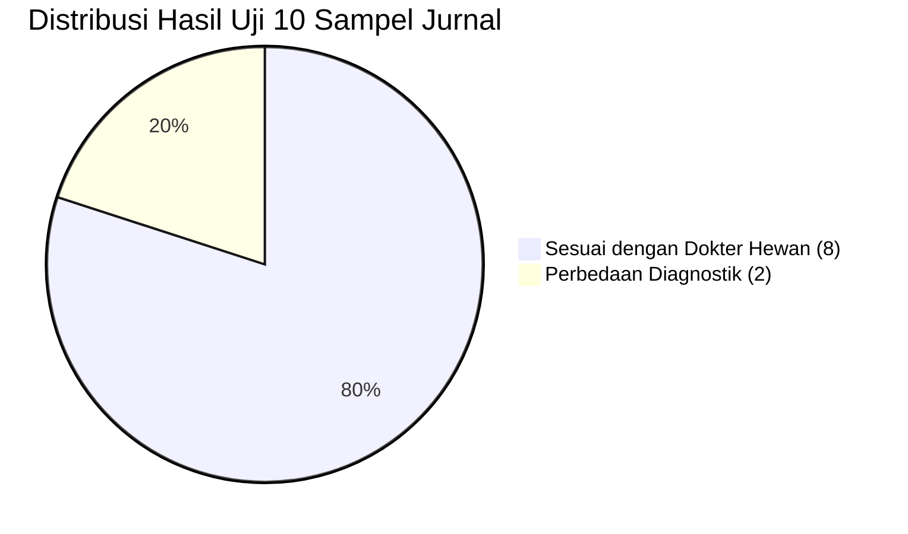

# VALIDATION & VERIFICATION REPORT
## AyamCare — Sistem Pakar Diagnosis Penyakit Ayam Broiler

**Versi Dokumen:** 1.0.0  
**Tanggal:** 8 November 2026  
**Status:** Phase 1 Deliverable — Validasi Matematis & Pengujian Sampel Empiris  

---

## 1. Matriks Pengujian Reproduktifitas (Tabel 6 Jurnal)

Validasi empiris dilakukan dengan menguji 10 sampel kasus ayam broiler nyata yang dicatat dalam penelitian Agustin, Mulyani & Sopandi (2024).

### Tabel Rincian 10 Kasus Sampel:

| No | Gejala Teramati Peternak | Prediksi Sistem Jurnal | Hasil Pakar / Dokter Hewan | Kesesuaian Artikel | Analisis AyamCare |
| :---: | :--- | :--- | :--- | :---: | :--- |
| **1** | Nafas ngorok, Keluar cairan hidung, Feses bintik kuning, Pucat, Nafas sesak | **CRD (100%)** | **CRD** | **Sesuai** | Pola respiratori kronis khas *Mycoplasma gallisepticum*. Kombinasi multipel menghasilkan keyakinan maksimal. |
| **2** | Keluar cairan mata & hidung, Kotoran kuning hijau, Batuk darah, Bulu kusam | **Salesma Ayam (80%)** | **Salesma Ayam** | **Sesuai** | Eksudat sinus dan kotoran hijau khas *Infectious Coryza*. |
| **3** | Nafsu makan berkurang, Cairan hidung, Lemas, Sesak nafas, Kepala berputar | **Gumboro (54%)** | **Gumboro** | **Sesuai** | Gejala sistemik awal dengan keterlibatan imunosupresi. |
| **4** | Perut membesar, Bulu kusam | **Tipus Ayam (36%)** | **Tipus Ayam** | **Sesuai** | Hepatomegali / splenomegali bakterial khas *Salmonella gallinarum*. |
| **5** | Nafsu makan berkurang, Cairan hidung, Lemas, Sesak nafas, Muka bengkak | **Tetelo (48%)** | **Tetelo** | **Sesuai** | Gejala awal *Newcastle Disease* sebelum manifestasi tortikolis terminal. |
| **6** | Kotoran putih di anus, Kotoran berdarah | **Berak Darah (80%)** | **Berak Darah** | **Sesuai** | Indikasi klasik *Coccidiosis* fase akut pada broiler usia 3-5 minggu. |
| **7** | Kepala bengkak, Mati mendadak | **Flu Burung (60%)** | **Berak Kapur** | *Tidak Sesuai* | **Diskrepansi 1:** Mortalitas mendadak dan edema kepala secara klinis lebih condong ke Avian Influenza perakut; dokter hewan mendeteksi lesi sekunder Pullorum melalui nekropsi. |
| **8** | Mencret keputihan, Paruh ditaruh di dasar, Lemas, Bulu kusam | **Busung Ayam (64%)** | **Gumboro** | *Tidak Sesuai* | **Diskrepansi 2:** Gejala depresi dan diare putih berhimpitan antara lymphoid leukosis dan stadium dehidrasi bursal disease. |
| **9** | Kotoran putih di anus, Nafas sesak | **Berak Kapur (36%)** | **Berak Kapur** | **Sesuai** | White vent pasting khas *Salmonella pullorum* pada anak ayam. |
| **10** | Bersin, Mati mendadak, Lendir mulut, Tidur paruh di lantai | **Batuk Darah (60%)** | **Batuk Darah** | **Sesuai** | Obstruksi trakea hemoragik akibat *Infectious Laryngotracheitis* (ILT). |

**Tingkat Akurasi Evaluasi:**  
$$\text{Akurasi} = \frac{8}{10} \times 100\% = 80.0\%$$

---

## 2. Pengujian Batas & Kasus Khusus (*Edge Cases*)

| Kasus Uji | Kondisi Input | Perilaku Sistem AyamCare | Status |
| :--- | :--- | :--- | :--- |
| **EC-01** | Pengguna memilih 0 gejala | Tombol "Lanjutkan" dinonaktifkan (`disabled`). Muncul instruksi memilih gejala. | **PASS** |
| **EC-02** | Pengguna memilih 1 gejala | Tombol dinonaktifkan. Sistem mewajibkan minimal 2 gejala demi akurasi diferensial. | **PASS** |
| **EC-03** | Gejala tidak memicu satupun aturan penyakit | Ditampilkan layar "Bukti Klinis Belum Cukup" disertai rekomendasi pemeriksaan langsung oleh dokter hewan. Sistem tidak memaksakan diagnosis palsu. | **PASS** |
| **EC-04** | Dua penyakit memiliki skor CF tertinggi sama (*Tied Score*) | Menampilkan kedua penyakit secara berdampingan sebagai diagnosa banding setara dengan penjelasan rinci. | **PASS** |
| **EC-05** | Semua gejala dipilih dengan $CF_{user} = 1.0$ | Algoritma kombinasi konvergen secara asimtotik mendekati $1.0$ ($100\%$) tanpa pernah melebihi $1.0$ (kestabilan numerik terjaga). | **PASS** |

---

## 3. Batasan Klinis & Pernyataan Keamanan (Clinical Safety Disclaimer)

> [!WARNING]
> 1. Persentase Certainty Factor ($CF$) adalah **skor tingkat keyakinan komputasional sistem**, bukan probabilitas klinis mutlak.
> 2. Penyakit ayam broiler seringkali bersifat **infeksi multietiologi** (misalnya CRD terkomplikasi oleh *E. coli* atau *Newcastle Disease* yang melemahkan sistem imun sehingga disusul koksidiosis).
> 3. Aplikasi **AyamCare** berfungsi sebagai *Clinical Decision Support System* (CDSS) penolong awal di peternakan, **bukan pengganti nekropsi patologi veteriner atau uji laboratorium serologis**.

